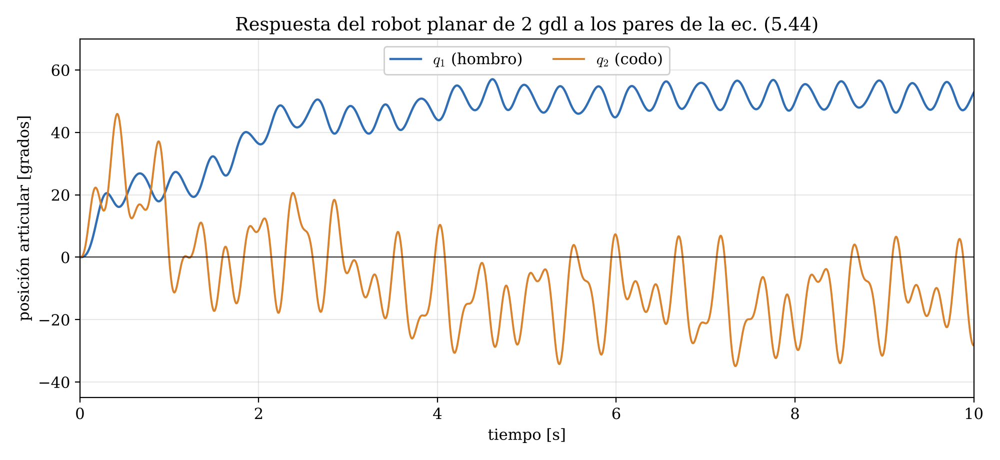
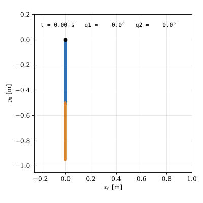

# Robot manipulador planar de 2 gdl: modelo Euler-Lagrange y simulación en Python

[](https://colab.research.google.com/github/Ferxxo-MV/2132259_PIA_MySSM/blob/main/robot_2gdl_euler_lagrange.ipynb)

PIA de **Modelado de Sistemas Mecatrónicos** (AF 7: Proyecto final). Se obtiene el modelo dinámico de un robot manipulador planar de 2 grados de libertad con el formalismo de Euler-Lagrange y se simula durante 10 s, a partir del ejemplo 5.3 de Reyes Cortés, *Robótica: control de robots manipuladores*.



<p align="center"></p>

## Qué contiene el notebook

[`robot_2gdl_euler_lagrange.ipynb`](robot_2gdl_euler_lagrange.ipynb):

1. Diagrama del robot con sus variables y los dos sistemas de referencia (Σ0 fijo en el hombro, Σ1 móvil en el codo), y la tabla 5.1 de parámetros.
2. Derivación simbólica con SymPy: cinemática de los centros de masa, energías, lagrangiano y ecuaciones de Euler-Lagrange de cada articulación, incluyendo los pares de los motores y la fricción (viscosa, de Coulomb y estática).
3. Separación en matriz de inercia M(q), matriz de Coriolis C(q, q̇), vector de gravedad g(q) y vector de fricción f(q̇, τ), con verificación de sus propiedades.
4. Simulación de 10 s (`solve_ivp`, RK45, paso máximo 0.0025 s) con el modelo numérico del libro, gráficas de q1(t) y q2(t), validación con RK4 y balance de energía, y animación del brazo.

Modelo simulado:

```
τ = M(q) q̈ + C(q, q̇) q̇ + g(q) + f(q̇)

M(q) = [3.117 + 0.2 cos q2    0.108 + 0.1 cos q2]
       [0.108 + 0.1 cos q2    0.108             ]
C(q,q̇) = [−0.2 sen q2 q̇2   −0.1 sen q2 q̇2]
         [ 0.1 sen q2 q̇1    0             ]
g(q) = [39.3 sen q1 + 1.95 sen(q1 + q2)]
       [1.95 sen(q1 + q2)              ]
f(q̇) = [1.86 q̇1 + 1.93 signo(q̇1)]
       [0.16 q̇2 + 0.30 signo(q̇2)]
```

## Cómo ejecutarlo

- **Colab:** botón *Abrir en Colab* de arriba. No hace falta instalar nada.
- **Local:**
  ```bash
  pip install -r requirements.txt
  jupyter notebook robot_2gdl_euler_lagrange.ipynb
  ```

## Estructura

```
├── robot_2gdl_euler_lagrange.ipynb   # notebook principal (ya ejecutado)
├── figuras/                          # imágenes generadas por el notebook
│   ├── diagrama_robot_2gdl.png
│   ├── posiciones_articulares.png
│   ├── velocidades_y_pares.png
│   ├── poses_estroboscopicas.png
│   └── robot_2gdl.gif
├── requirements.txt
└── README.md
```

| Nombre | Matrícula |
|---|---|
| Fernando Muñiz Valencia | 2132259 |

## Referencia

Reyes Cortés, F. (2020). *Robótica: control de robots manipuladores*. Marcombo.
